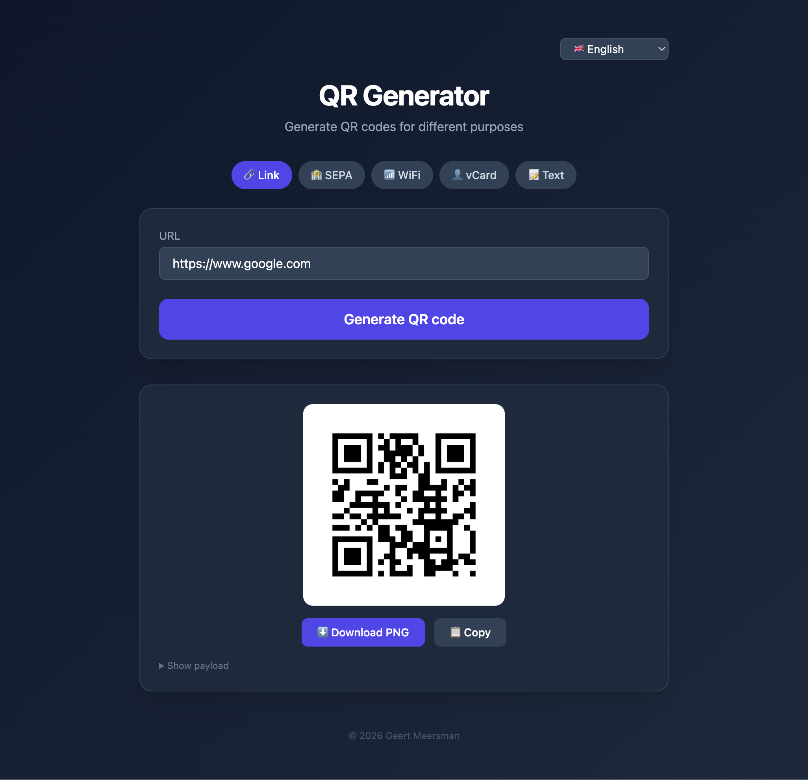

<p align="center">
  <a href="https://github.com/geertmeersman"></a>
  <a href="https://www.buymeacoffee.com/geertmeersman"></a>
</p>

<p align="center">
  <a href="LICENSE"></a>
  
  
</p>

<p align="center">
  <a href="https://github.com/geertmeersman/qr-generator/actions/workflows/docker-publish.yml"></a>
  <a href="https://github.com/geertmeersman/qr-generator/actions/workflows/pr-validate.yml"></a>
</p>

<p align="center">
  <a href="https://github.com/geertmeersman/qr-generator/issues"></a>
  <a href="https://github.com/geertmeersman/qr-generator/pulls"></a>
  <a href="https://github.com/geertmeersman/qr-generator/commits/main"></a>
</p>

Flask-based QR code generator with multi-language support, based on `python:3.13-slim`.



## Current versions

| Component | Version |
|-----------|---------|
| Python | 3.13 |

## What's inside

- Flask + Flask-Babel (i18n: nl, en, fr, de)
- qrcode[pil]

## Supported QR types

| Type | Description |
|------|-------------|
| URL | Any web URL |
| SEPA | European bank transfer (BCD format) |
| WiFi | WiFi network credentials |
| vCard | Contact card (v3.0) |
| Text | Plain text |

## Usage

```bash
docker pull geertmeersman/qr-generator:latest
docker run -p 5000:5000 geertmeersman/qr-generator:latest
```

Or with Docker Compose:

```yaml
services:
  qr-web:
    image: geertmeersman/qr-generator:latest
    container_name: qr-web
    ports:
      - "5000:5000"
    healthcheck:
      test: ["CMD", "curl", "-f", "http://localhost:5000/health"]
      interval: 30s
      timeout: 5s
      retries: 3
    restart: unless-stopped
```

Open `http://localhost:5000` in your browser.

## Auto-updates

The image is automatically rebuilt and pushed to Docker Hub whenever the upstream `python:3.13-slim` image is updated (checked daily).

---

© 2026 [Geert Meersman](https://github.com/geertmeersman) — Licensed under the [MIT License](LICENSE)
